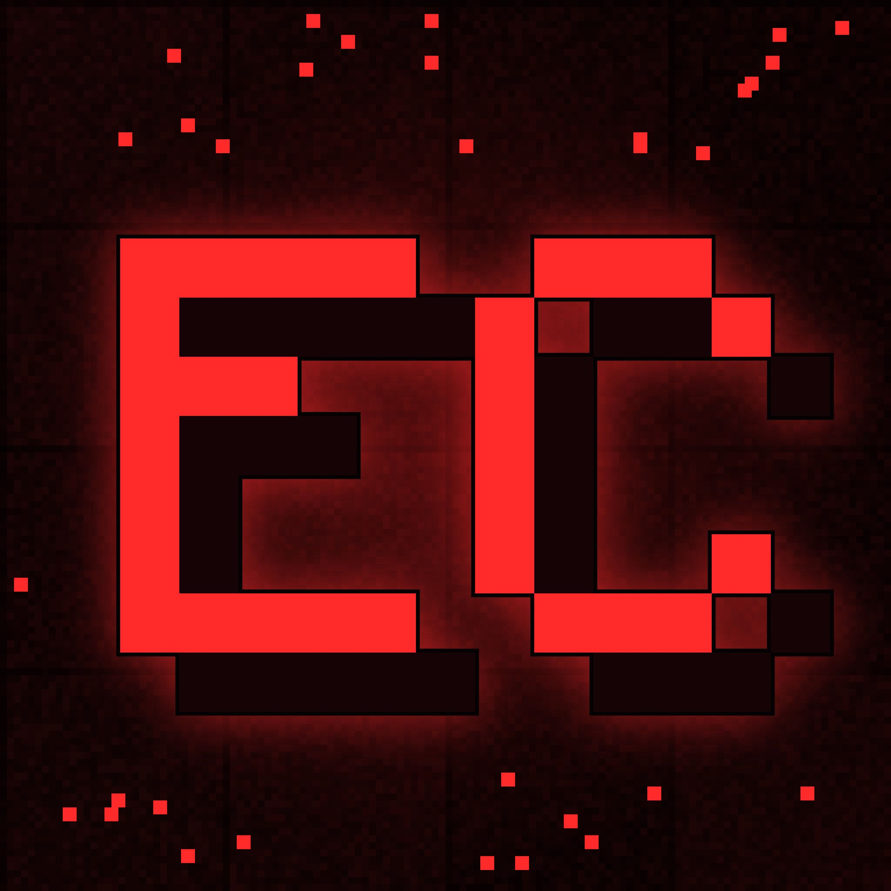
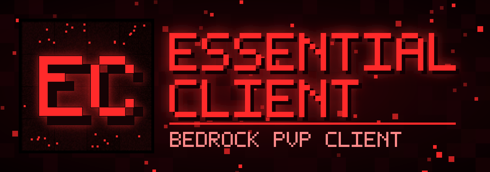

  

<h1 align="center">Essential Client</h1>

A fair play PvP client for Minecraft Bedrock on Windows.

  <a href="https://github.com/zvryyy/essential-client-updates/releases/latest"><b>Download the launcher</b></a>
  ·
  <a href="https://discord.gg/QBEV4jbJBY"><b>Discord</b></a>

  

## Features

- FPS boost
- Clean HUD: FPS, CPS, ping, coordinates, armor and potion status
- Keystrokes, including controller layout
- Zoom, custom crosshair and themes
- Hitbox outlines, better health bars and viewmodel
- Toggle sprint, combo counter and reach display

No reach, no aim help, no auto click, no seeing through walls.

## Install

1. Download `Essential-Client-1.2.7.exe` from the latest release
2. Open it. If Windows says "Windows protected your PC", press **More info**, then **Run anyway**
3. Get your activation code in the Discord, then press **Launch**

The launcher keeps itself and the client up to date. You only download it once.

## Requirements

Windows 10 or 11 with Minecraft Bedrock from the Microsoft Store or Xbox app.

---

This repository only contains released builds and the signed update list the launcher reads.
